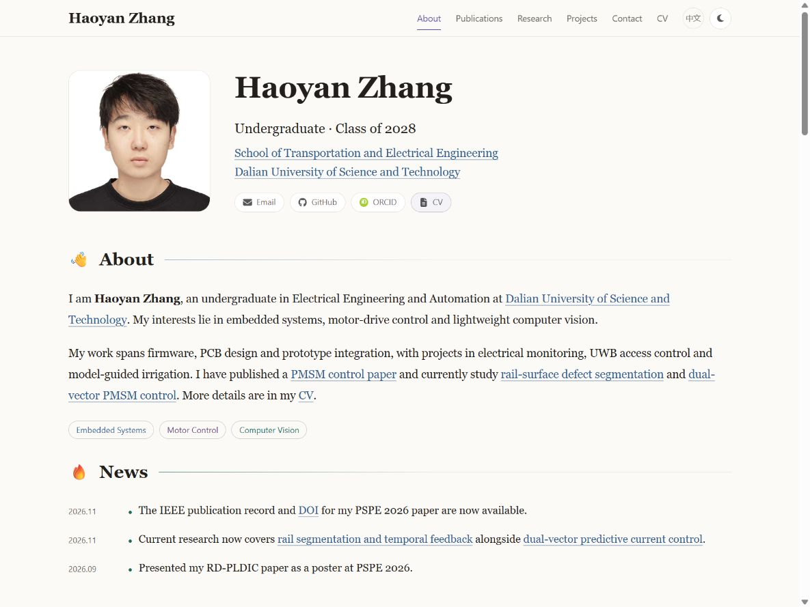

# Haoyan Zhang

Academic homepage · Electrical Engineering and Automation

**[Visit my homepage](https://wangyansir.github.io/)** · [Chinese version](https://wangyansir.github.io/zh.html) · [CV](https://wangyansir.github.io/assets/haoyan-zhang-cv.pdf)

Explore publications, current research and engineering projects on the website. Click the preview above to open it.

This repository contains the static website published with GitHub Pages. The English interface is the default; the language control switches to Chinese.

© 2026 Haoyan Zhang. The accepted manuscript carries its IEEE copyright notice. Font Awesome icon licensing is included in assets/icons/LICENSE.txt.
